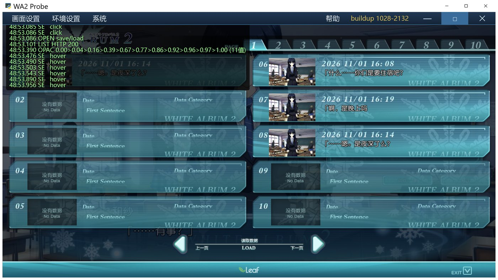
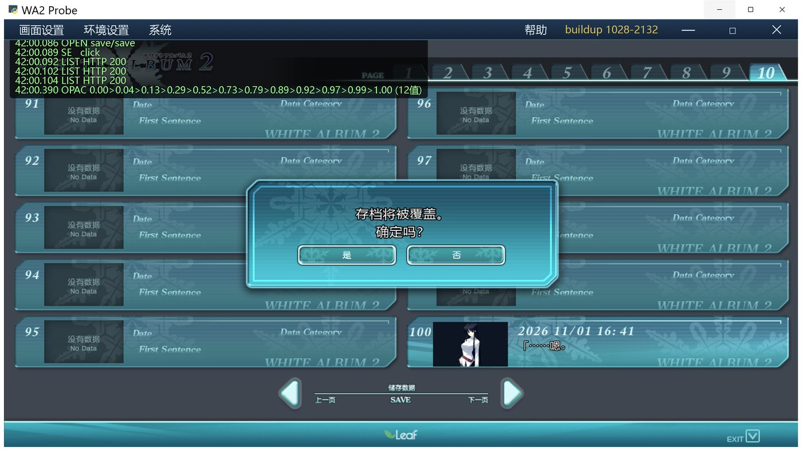
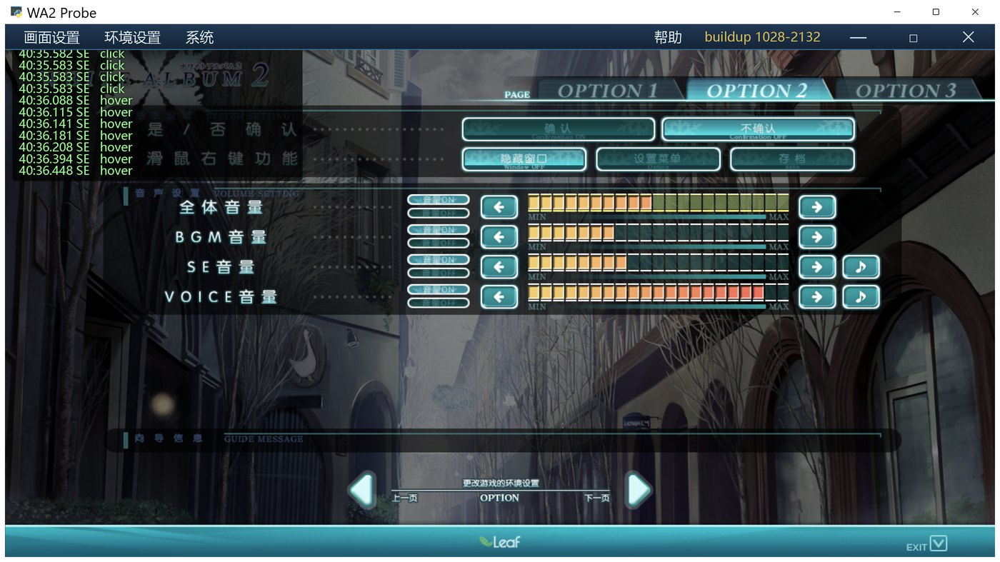
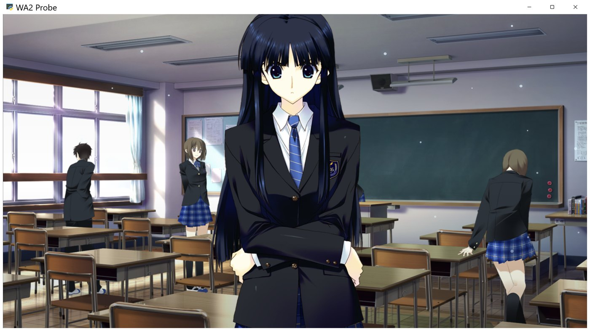

# 开发日志 2026-11-01 16:45

> 项目：WHITE ALBUM 2 · 冬马和纱 桌面程序
> 本次跨度：11-01 16:26 ~ 16:46
> 主题：存档界面恢复、OPTION 2 全部控件接通、音量链路修复、界面自测闭环

本轮是「接上一轮交接」的一次修复：上一轮把两个界面故障误判成"路由/热区/缓存"，
实际是两个**语法层面的静默失效**。两处都已定位到具体 commit。

---

## 一、存档界面全军覆没：`__renderSaveSlotsNow` 被整文件重写吞掉

**现象**（上一轮记录）：10 个槽位全是「没有数据」，`fetchList()` 一条日志都不打。

**根因**：commit `4d1927d`（换页动画改用 WAAPI）把 `savepages.js` 整个文件重写了一遍，
重写时**丢掉了 `window.__renderSaveSlotsNow` 的定义**，只留下：

```js
window.__renderSaveSlots = function (page) {
  window.__savePage = page;
  window.__renderSaveSlotsNow(page);   // ← 这个函数已经不存在
};
```

而 `paint()` 与 `fetchList()` 虽然还在文件里，**调用点全在丢掉的函数体内**，
于是两个函数都成了死代码：

- 槽位编号 / 缩略图 / 时间戳 / 末句没人画 → 看到的是 `slot_nodata.png` 底图自带的静态文字
- `/api/session/list` 根本没发出去 → 日志里当然没有 `LIST`
- 异常被 `screens.js` 那句 `try { ... } catch (e) {}` 吃掉 → 界面上毫无提示

上一轮"后端是好的、磁盘存档是好的、路由是对的"三个结论都对，只是没往"JS 函数不存在"这个方向看。

**修法**：补回定义（先用旧 state 画一帧、再拉服务器列表重画一次）。

## 二、`game.js` 里一个 `''` 吞掉了最后 56 行

**现象**：右键完全没反应；「全体音量」「VOICE」滑块拖了没用。

**根因**：commit `5e6b4fb` 清理死函数 `fadeSwap` 时，把函数体删了却留下一个占位行：

```js
window.fadeInScreen = function (el, ms) { ... };
''                       // ← 残留
/* 回想面板滚轮… */
(function () { ... })();
```

JS 里 `''` 后面紧跟 `(...)` 会被解析成**调用**：`''(function(){...})()`，
于是控制台报 `TypeError: "" is not a function`，**文件在这个位置就断了**，
后面 56 行（音量总控、右键功能、隐藏界面的 CSS 注入）一条都没执行。

**修法**：删掉那个 `''`。

**教训**：删函数要连"空占位"一起删；一个顶层语法/运行期错误会让它后面的整个文件失效，
而文件前面的代码照常工作——所以现象是"只有某几块功能没了"。

## 三、存档列表没回来就点槽位 → 直接覆盖真存档

**现象**（排查中发现的隐患）：打开存档界面后立刻点一个已有存档的槽，不弹覆盖确认，
直接写掉。因为 `state` 还是空的，`el.classList.contains("filled")` 是 false。

**修法**：加 `listReady` 标记；没拉回列表时点击先触发一次拉取，拿到结果后再处理这次点击。
拉取失败也不清空 `state`（清空等于把已有存档当空槽）。

## 四、OPTION 2：三处独立 bug，叠在一起就是"每个按钮都没实现"

1. **`CT2` 是 IIFE 内部变量**。文件末尾的 `ct2Pct / __ct2State / applyCt2 / 启动还原`
   都在 IIFE 外面，读 `CT2` 直接 `ReferenceError`，而调用处又包着 `try/catch`
   → 表现是「界面能点、状态不保存」。
   修法：`var CT2;` 提到文件顶层。
2. **选中分支不落盘**。`clickWidget()` 的"取消选中"分支调了 `applyCt2()`，
   "选中"分支没调 → 「是否确认」「右键功能」只在画面上变，`prefs` 里还是旧值。
3. **右键功能的索引错位**。控件表被删过条目之后，`sel[7] / sel[24]` 指向的其实是
   "音量ON/OFF"和已经删掉的那一行。按原始控件表
   （`res/assets/ui/opt/ct2/widgets.js.txt`）改成 `2=隐藏窗口 3=设置菜单 4=存档`。

**顺带补齐**（原来点了没反应）：

| 控件 | 现在的行为 |
|---|---|
| 每条音量的左右箭头 | ±1 格 = ±5% |
| 音量 ON / OFF | ON = 满格，OFF = 静音；随滑块自动同步显示 |
| 翻页时中断语音 | 按用户要求删除：控件热区 + 底图那一行一起删（底图 y=286~346 透明化） |

## 五、音量链路：VOICE 从来没接过，BGM 不乘主音量

| 问题 | 修法 |
|---|---|
| `speakReply()` 与回想重播都写死 `a.volume = 1.0` | 新增 `voiceVolume()`（VOICE 滑块 × 全体音量），两处都改用它 |
| `__applyVolumes()` 操作 `window.__bgmAudio / window.__voiceAudio` | 这两个变量从未赋值过；改成直接用模块内的 `bgmAudio / ttsAudio` |
| `bgmVolume()` 只读旧 `bgmVol`，不乘主音量 | 改为 `volBgm（或旧 bgmVol）× volMaster` |

实测：`volVoice=40, volMaster=50` → `ttsAudio.volume=0.2`，`volBgm=30, volMaster=50` → `bgmAudio.volume=0.15`。

## 六、右键「隐藏窗口」其实只隐藏了底部工具栏

隐藏用的 CSS 选择器是 `.dialogBox / #menubar / #quickBar` —— 这三个在 DOM 里都不存在
（对话框是 `#msgWrap`，菜单栏是 `#menuBar`）。改成真实 ID 后：消息框、输入栏、工具栏、
菜单栏、回想、调试面板全部隐藏，只留背景与立绘。

## 七、补上自测闭环（本轮最重要的工具）

上一轮"一整轮没法自测"的根因是只有 `--serve-only` 一条路，而它验证不了 JS。
本轮实测 `--serve-only` **能正常起**（8771 端口），但发现它有个更阴的坑：
Windows 的 `SO_REUSEADDR` 让**两个进程能同时绑 8771**，后起的那个"绑定成功"
却抢不到连接，表现就是"进程活着、端口不响应"——上一轮很可能就是撞在这个坑上。
修法：`allow_reuse_address = False`，并让 `--port` 参数真正生效（原来被忽略）。
现在：`--port 8791` 就用 8791，端口被占则顺延 8771 → 8772 → 随机。

另外新增 `tools/ui_probe.py`：

- 开一个真的 WebView2 窗口（和正式程序同一引擎）
- 用 `evaluate_js` 驱动（点按钮、改状态、读 DOM）
- 用 Win32 `PrintWindow` 截图，能直接看到画面

有了它，本文里每个结论都有执行证据：槽位 class、`LIST HTTP 200`、`prefs` 落盘值、截图。

### 顺手复核了「transform 过渡失效」

用一个普通 div 在真实 WebView2 里逐帧采样：

| 属性 | 结果 |
|---|---|
| `transform`（transition） | ❌ 采样 1 种值，恒为 `none`（**连静态 transform 都被丢弃**，不只是过渡） |
| `filter: blur()` | ✅ 20 种渐变值 |
| `zoom` | ✅ 20 种渐变值 |
| `opacity` | ✅ 20 种渐变值 |

→ 换页动画的"收缩"可以用 `zoom` 代替 `transform: scale()`，不需要 canvas 快照。
（这条留给下一步，本轮不动动画。）

### 采样时机（新坑）

改完 class **立刻**读 `getComputedStyle().opacity` 会拿到**过渡前的值**。
要么等过渡跑完再读（`ui_probe.py --check`），要么用 `setInterval` 采样，
不要用 `requestAnimationFrame`——探针窗口被遮挡时 rAF 会被节流到不触发。

---

## 改动文件

| 文件 | 改动 |
|---|---|
| `src/ui/savepages.js` | 补回 `__renderSaveSlotsNow`；`listReady` 守卫；拉取失败不清空 state |
| `src/ui/game.js` | 删 `''`；`voiceVolume()`；修 `__applyVolumes` / `bgmVolume`；重写隐藏界面的选择器 |
| `src/ui/opt.js` | `CT2` 提为全局；选中即落盘；右键索引 2/3/4；箭头与 ON/OFF；删翻页中断 |
| `src/ui/index.html` | `?v=` 统一 bump |
| `tools/ui_probe.py` | 新增自测探针 |
| `tools/README.md` | 补自测说明 |
| `res/assets/ui/opt/opt2_base.png` | 抹掉"翻页时中断语音"那一行（不在仓库里） |

## 验证记录

- 存档：第 10 页点空槽 100 → 落盘（2 条消息 + 缩略图）→ 列表变 filled → 读档回到游戏，`msgText` 用 `/api/text` 渲染
- 覆盖确认：点已有档 → 弹「存档将被覆盖。/ 确定吗？」（两行字模都在）
- OPTION 2：`prefs` 实测写入 `confirmAsk / rightClick / volMaster / volBgm / seVol / volVoice`
- 右键三种模式：隐藏（只剩 CG+立绘）/ 设置 / 存档
- OPTION 3：三个模型板块正常

### 画面（`tools/ui_probe.py` 截图）

| | |
|---|---|
|  |  |
| 存档界面：槽位 / 缩略图 / 时间戳 / 末句都回来了 | 覆盖确认：两行字模 + 是/否 |
|  |  |
| OPTION 2：确认=不确认、右键=隐藏窗口、全体 45% | 右键隐藏后只剩 CG 与立绘 |


## 待办

- 换页动画：改用 `zoom` + `filter: blur()` + `opacity`（transform 不可用，已有实测依据）
- TTS 服务当前 503（`/api/voice/ok` 返回 `ready:false`），语音端到端没测；音量链路已用假 audio 验证
- `#optScreen` 的 86% 半透明底会让游戏底部工具栏隐约透出来（预存在，未动）
