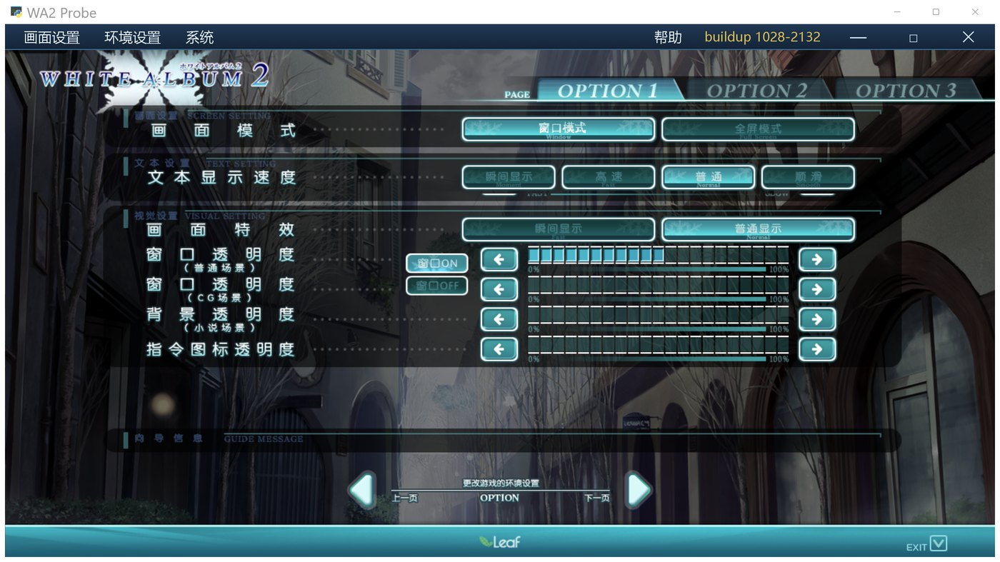
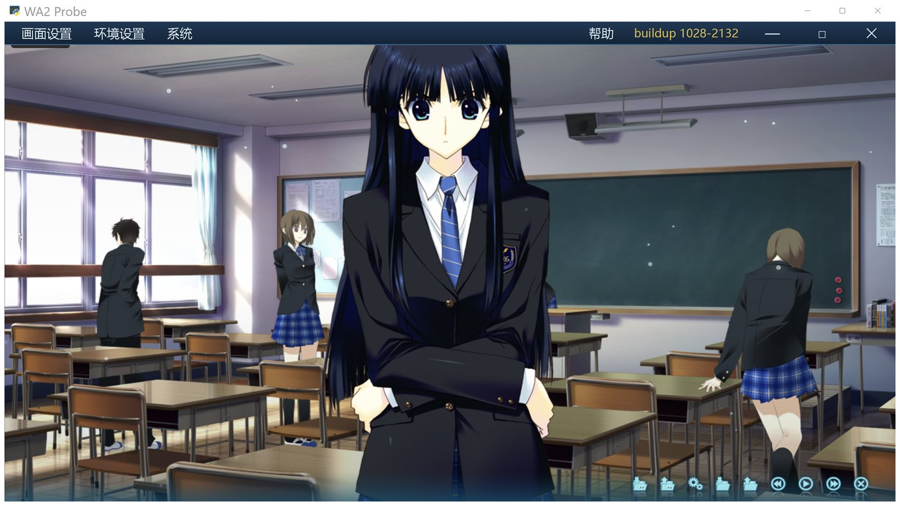
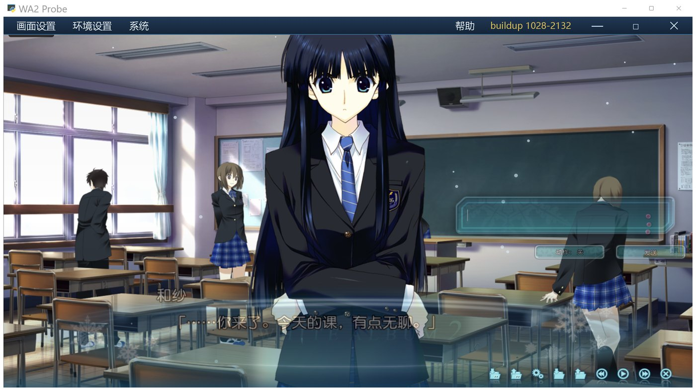

# 开发日志 2026-11-01 17:20

> 项目：WHITE ALBUM 2 · 冬马和纱 桌面程序
> 本次跨度：11-01 17:00 ~ 17:20
> 主题：OPTION 1 窗口功能（窗口/全屏、文字速度、对话框显隐与透明度）

用户验收通过上一轮（存档 / OPTION 2 / 音量）之后，这一轮做 OPTION 1。

---

## 一、需求与做法对照

| 需求 | 做法 | 状态 |
|---|---|---|
| 窗口模式 / 全屏模式 | 点「全屏模式」→ `GET /api/window?action=fullscreen&on=1`；点「窗口模式」→ `on=0`。后端按**目标状态**切 `toggle_fullscreen()`，不是盲目 toggle | ✅ |
| 文本显示速度 | 真打字机：`瞬间`整段出，其余按每字 14 / 30 / 50ms 逐字显示，标点停 3 倍 | ✅ |
| 文本快进模式 | 删除（实时对话没有快进） | ✅ 控件 + 底图都去掉 |
| 自动模式速度 | 删除（同上） | ✅ 控件 + 底图都去掉 |
| 画面特效 | 按用户要求**先不做**，保留控件外观 | — |
| 窗口透明度（普通场景） | 管对话框 + 输入栏（含发送/动作按钮）的整体透明度，0 = 完全看不见（同时不吃点击） | ✅ |
| 窗口 ON / OFF | ON 显示对话框与输入栏，OFF 全部隐藏 | ✅ |
| 窗口透明度（CG 场景）/ 背景透明度 / 指令图标透明度 | 按用户要求**先不做**，滑块能拖但不起作用 | — |

---

## 二、文字速度：之前"几个速度没区别"的原因

原来的 `renderPage()` 走的是 `gdiRenderMsg()`：**服务端把整段话渲染成一张 PNG**，
一次性贴上，根本没有逐字过程。`legacyTypewriter` 里那套 speed 逻辑只在 GDI 失败时才跑，
所以四个档位看起来完全一样。

要逐字显示，又不能一个字一张图（太慢、会重新排版）。做法：

1. `sub_render.py` 的排版是**固定网格**：每字 32×32 格子、水平步进 28px、
   每行 20 字、行高 32px（`FONT_ADVANCE / FONT_PER_LINE / FONT_OCCUPATION`）。
2. 整段图照旧一次渲染出来，然后按「显示到第几个字」反推裁剪区域：
   已完成的行整行可见，当前行只显示到第 N 个字 → 一个 `clip-path: polygon()` 就能表达。
3. 排版模型和真实图片对不上时（比如文本里有换行符），**自动放弃动画**直接整段显示，
   判据是 `|图高 - 行数×32| <= 2`。这条自检很关键：宁可不动画，也不能切错位置。

实测（26 字）：`高速` 621ms、`顺滑` 2181ms、`瞬间` 21ms（无裁剪）。

打字途中点一下对话框 = 立刻出完整句（和 galgame 一致）。

## 三、删行不能重新编号：控件图是按索引命名的

`assets/ui/opt/ct/w00..w21_sel.png` 是**按控件索引**命名的。
删掉「文本快进模式（6/7）」「自动模式速度（8/9）」之后如果重新编号，
画面特效会去拿"全文/仅限已读"的图 —— 一按就张冠李戴。

所以 `CT.widgets` 里被删的位置留 `null`，创建/贴图/热区都跳过，
`clip-path` 无关的索引完全不变。教训写进踩坑记录。

## 四、输入栏不跟着变透明：`opacity: 1 !important`

`game450.css` 末尾有一条 `#inputBar { opacity: 1 !important }`（第十一版改版留下的）。
普通内联样式压不住它，所以第一次测出来"消息框透明了、输入栏没变"。
改成 `el.style.setProperty("opacity", op, "important")` 才对。

## 五、全屏：先确认后端这条路真的能用

上一轮交接里写着"全屏改成 `pywebview.toggle_fullscreen()`，未验证"。
这轮用真实窗口实测了一次（frameless + 1280×720）：

| 状态 | 窗口矩形 |
|---|---|
| 初始 | 427,462 → 3168×1707（2.5× DPI 下的 1280×720） |
| 全屏 | 0,0 → 3840×2160 |
| 退出全屏 | 427,462 → 3168×1707（原样还原） |

所以 `toggle_fullscreen()` 在无边框窗口上可用，不会出现"铺满屏幕点不动"的老问题
（那是浏览器 Fullscreen API 的锅）。

顺带解决了状态同步：

- 后端 `fullscreen&on=` 按目标状态切，并用 `w._wa2_full` 记录；
- 标题栏菜单的「全屏模式」切换后会回调 `__ct1SetWinModeUI()`，
  OPTION 1 的高亮跟着变，不会出现"界面说全屏、窗口其实是窗口"。

## 六、底图改动（不在仓库里）

`res/assets/ui/opt/opt1_base.png`：

- 删掉「文本快进模式」「自动模式速度」两行（y=116~199）；
- 原「视觉设置」整段上移 74px，向导信息条保持在底部。

所以代码里的 y 坐标都减了 74：画面特效 148、普通场景 188、CG 228、小说 268、指令 308。
换机器要重新处理这张图（或在 `tools/` 里补个脚本）。

---

## 验证记录（`tools/ui_probe.py`）

- OPTION 1 布局：18 个控件热区 + 4 条滑块，高亮落在「窗口模式 / 普通 / 普通显示 / 窗口ON」
- 点「顺滑」→ `prefs.textSpeed = 3`；点「瞬间」→ `0`
- 点「窗口 OFF」→ `body.dlgHidden`，消息框与输入栏 opacity 都是 0
- 拖动透明度到 50% → `#msgWrap` / `#inputBar` 的 computed opacity 都是 `0.5`
- 打字机：26 字在 3 档速度下分别 21 / 621 / 2181 ms，裁剪路径出现 12 种不同值
- 打字途中点对话框 → 裁剪清空、`typing = false`
- OPTION 2 回归正常（CT / CT2 两个控件表都在 IIFE 外，互不影响）

### 画面

| | |
|---|---|
|  |  |
| OPTION 1：只剩需要的行，滑块位置已重排 | 窗口 OFF：对话框与输入栏都不显示 |
|  | |
| 透明度 40%：对话框、输入栏一起变淡（背后 CG 透出来） | |

## 待办

- `画面特效`、`窗口透明度（CG 场景）`、`背景透明度（小说场景）`、`指令图标透明度` —— 按用户要求暂不做
- 更快/更慢的文字速度档位要不要再调，等实机手感反馈
- 语音端到端仍未验证（TTS 服务 503）
- 换页动画（`zoom + blur` 方案已实测可行）
