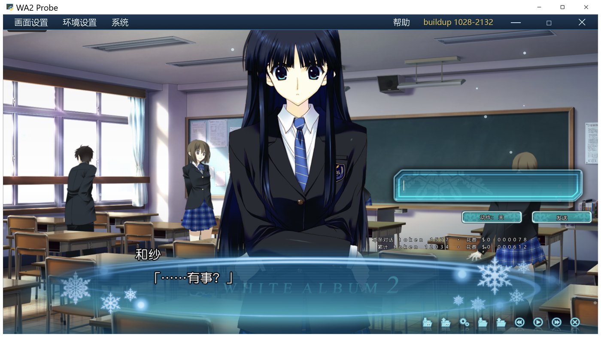

# 开发日志 2026-11-01 18:30

> 主题：右下角实时显示本条 / 累计 token 与花费

## 一、做了什么

对话界面右下角（发送按钮下方）两行小字，走统一字模接口渲染：

```
本条对话 token 1577 · 花费 ¥0.000521
累计 token 12034 · 花费 ¥0.004117
```

- **本条**：最近一次对话调用的用量（输入 + 输出）
- **累计**：本次打开程序以来所有 API 调用（对话 + 记忆书总结）加起来
- 程序启动时先拉一次累计；之后每条回复更新，另外每 20 秒拉一次累计
  （因为记忆书总结是后台跑的，不刷新看不到）



## 二、数字从哪来

1. **token**：直接用接口返回的 `usage` 字段（`prompt_tokens` / `completion_tokens` /
   `total_tokens`，DeepSeek 还带 `prompt_cache_hit_tokens`）。不是估算，是账面上的真实值。
2. **价格**：新增 `src/pricing.py`，从**官网价格页**
   `https://api-docs.deepseek.com/zh-cn/quick_start/pricing`（中文页，标的是**元**） 抓表格解析，
   缓存 6 小时（`cache/prices.json`）；抓不到就用内置兜底表，**查价失败绝不影响对话**。
3. **计费口径**按官方说明：
   - 输入分「缓存命中 / 未命中」两档；输出一档
   - 高峰时段（UTC 周一~周五 01:00-04:00、06:00-10:00）单价翻倍，其余半价
   - 币种是**人民币**（中文页的价目表；英文页是美元，之前抓错了页面）

实测一次真实调用：`1511 in / 66 out` → `¥0.000521`，
其中约 1280 token 走了缓存命中价，所以比全按未命中算便宜很多。

## 三、改了什么

| 文件 | 改动 |
|---|---|
| `src/pricing.py` | 新增：抓价格页、解析、缓存、高峰判断、算钱 |
| `src/main.py` | `_record_usage()` 累计器；`_chat` / 记忆总结都记一笔；新增 `GET /api/usage`、`GET /api/price` |
| `src/ui/index.html` | `#costBar` 两行容器 |
| `src/ui/game.js` | `renderCost()` / `__refreshCost()`，收到回复就更新 |
| `src/ui/game450.css` | `#costBar` 定位：`right:93px; bottom:127px`（用户框的位置） |

## 四、踩的坑

**字模接口默认每行 20 字**：`/api/text` 不带 `chars_per_line` 时会按 20 字折行，
一行字被拆成两行，再按 8px 高显示就糊成一团。
修法：请求里带 `chars_per_line=80&max_width=4000`，保证一行。

## 五、币种：一开始抓错了页面

第一版抓的是**英文页**，价格是美元；用户要求显示人民币，所以改抓**中文页**
（同一张表，单位是元）：

| deepseek-flash | 空闲时段 | 高峰时段 |
|---|---|---|
| 输入（缓存命中） | ¥0.02 / 1M | ¥0.04 / 1M |
| 输入（未命中） | ¥1 / 1M | ¥2 / 1M |
| 输出 | ¥4 / 1M | ¥8 / 1M |

接口里的 `currency` 字段会跟着返回，前端按 `CNY` 显示 `¥`、按 `USD` 显示 `$`。

## 六、注意

- 价格页是**网页**不是 API，官方改版可能解析失败 → 会自动退回内置表（日志/接口里 `source` 字段能看到是 `official` 还是 `builtin`）
- 内置表是 2026-11 的数字，长期不更新会过期；`source=official` 时以线上为准
- 中国法定节假日没判断（只按周末算），会被按高峰价计 —— 影响很小（少算一点点）
