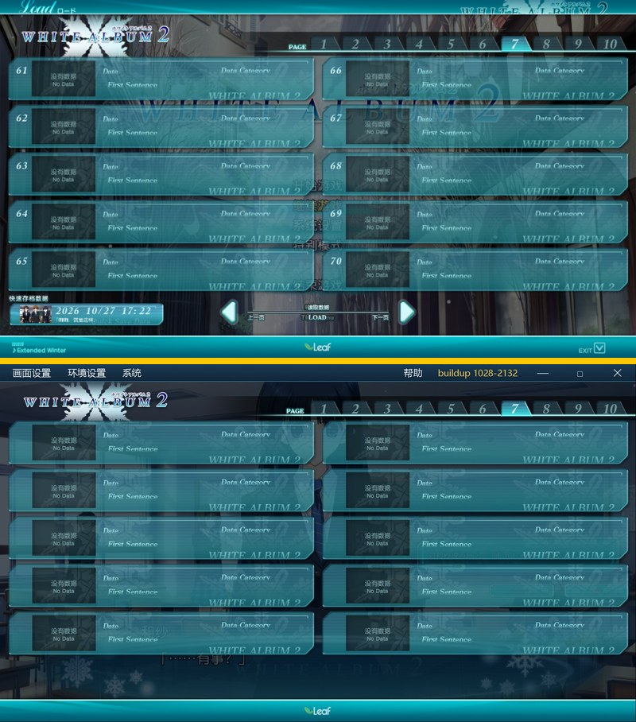
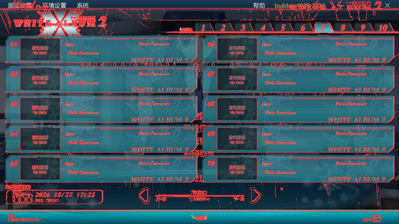

# 界面像素测量方法

> 这份文档记录本项目**唯一可靠**的「把游戏原版界面搬到 800×450 舞台」的测量方法。
> 写于 2026-11-01，用来替换此前所有靠肉眼估算的坐标。
>
> 一句话结论（存档界面，可直接抄）：**槽位 395.0×60.0、行距 60.0、左列 x=5.4、右列 x=400.4、首行 y=69.9**。

---

## 一、为什么需要它

存档界面之前反复对不齐，根因不是「手抖」，而是三件事：

1. **两个换算系数混用**：1708 宽预览图的 `800/1708 = 0.4684` 和 2730 宽原图的 `800/2730 = 0.2930`
   用混了会得到 1.6 倍的误差。
2. **背景图被压扁**：格子写 379.4×39.8，而素材本身是 1896×288（宽高比 6.58），
   379.4/39.8 = 9.53 —— 竖着压掉了 31%，字都是扁的，但「看习惯了就不觉得」。
3. **行距错 5.6px**：每行越往下偏得越多，到第 5 行已经差 30px，
   所以永远调不好——改一行好一行，下一行又歪。

一次正确的测量可以把「改十几轮」变成「改一次 + 回测一次」。

---

## 二、坐标系与换算（先看这一节）

| 项目 | 值 |
|---|---|
| 舞台 | **800 × 450**，运行时按窗口等比拉伸（`fitStage`） |
| 原图 `g2.jpg` | **2730 × 1536**（原版 Load 界面第 7 页，61~70 全 No Data） |
| 2730 图 → 舞台 | **× 0.293040**（即 ÷ 3.4125） |
| 1708 预览图 → 舞台 | **× 0.468384** |
| 1280×720 设计稿 → 舞台 | ÷ 1.6 |

**主测量在 2730 原图上做**（分辨率高、误差小），**再用 1708 预览图交叉验证**
（两个系数独立算，能立刻发现「是不是记错系数了」）。

界面素材绝大多数是 1280×720 设计稿导出的，所以还有一个强校验：
**`素材宽 × 0.625 = 舞台宽`**（0.625 = 800/1280）。

---

## 三、五条原则

1. **先确认这张图多宽，再把系数写进代码注释。** 不要凭记忆。
2. **不要用眼睛读坐标。** 用素材本身当模板：素材内部的纹理、边框、缩略图框，
   就是最准的尺子。眼睛读出来的值只能用来验证，不能用来定值。
3. **用「中位数剖面」压掉文字。** 沿一个方向取 `np.median`，文字只占少数像素，
   会被中位数直接抹掉，剩下的就是干净的盒子亮度曲线。
4. **宽高比必须等于素材的宽高比。** 这是唯一能自动发现「元素被压扁」的检查。
   算出来的 `宽/高` 和 `素材宽/素材高` 差超过 1% 就说明有一处错了。
5. **改完必须用同一套检测器在渲染结果上再量一遍**，并和原图的数字并排放。

---

## 四、操作步骤

### Step 0　参考图必须是整帧

原图长宽比必须是 16:9（2730/1536 = 1.7773）。不是整帧的图（带黑边、被裁过）
不能直接量，所有换算都会错。

### Step 1　找重复特征，先定行距

槽位每行都有一条**最亮的横线**（表头白线）。沿 x 取中位数得到 1D 亮度曲线，
取局部极大值就是每行的 y：

```python
prof = np.median(lum[:, 200:1250], axis=1)      # 压掉文字
peaks = [i for i in range(200, 1300)
         if prof[i] > 118 and prof[i] >= prof[i-1] and prof[i] >= prof[i+1]]
pitch = np.mean(np.diff(peaks[:5]))
```

实测：`peaks = [262, 467, 672, 877, 1082]`，相邻差 205/205/205/205
→ **行距 204.75 图上px → 60.00 舞台px**。

> 先用「相邻差值的众数」确认是行距而不是别的周期。这里四段全是 205，很稳。

### Step 2　由行距反推格子高度

槽位素材 `slot_nodata.png` 是 1896×288（3 倍超采样自 632×96 的格子）。
游戏里格子是**紧挨着排**的，所以：

```
素材画布高度 288 → 图上 204.8（= 行距）
缩放 s = 204.8 / 288 = 0.7109
格子画布宽 = 1896 × 0.7109 = 1348 图上px
```

**自检**：1348 / 204.8 = 6.58，正好等于 1896/288 = 6.58 ✔

### Step 3　50% 交叉点定亚像素边界

边缘是渐变的，取「这一段的最大值和最小值的中间值」交叉点，精度能到 0.1px：

```python
def cross(p, i0, i1, rising):
    seg = p[i0:i1+1]
    mid = (seg.max() + seg.min()) / 2
    for k in range(len(seg)-1):
        if (seg[k] < mid <= seg[k+1]) if rising else (seg[k] > mid >= seg[k+1]):
            return i0 + k + (mid - seg[k]) / (seg[k+1] - seg[k])
```

得到左边框 x=36.3、右边框 x=1346.9（左列第 1 格），宽 **1310.6**。

### Step 4　把素材坐标和图上坐标对上

素材里右边框在第 1867 列，左上可见边在第 25 列。于是：

```
s = (1346.9 - 36.3) / (1867 - 25) = 0.7115     ← 和 Step 2 的 0.7109 一致 ✔
素材原点在图上 x = 36.3 - 25×0.7115 = 18.5
素材原点在图上 y = 262  - 33×0.7115 = 238.5    ← 33 是素材里白线所在行
```

> **两个方向算出的 s 必须一致**（0.7109 vs 0.7115，差 0.1%）。
> 如果差得多，说明素材本身被拉伸过，光靠等比缩放对不上。

### Step 5　交叉验证（防止系数记错）

把同一张图缩到 **1708 宽**，用同一套检测器再量一次：

```
1708 图上行距 = 128px  → 128 × 0.4684 = 59.96 舞台px  ✔ 和 60.00 一致
```

这条极其重要：如果这里得到 82 或 37，说明某一步用错了系数。

### Step 6　写进 CSS，注释里留读数

```css
/* 几何量自 g2.jpg（2730x1536 全屏原图），系数 800/2730 = 0.293040：
   资产槽位格 1896x288（3x 的 632x96）在图上画成 1348x204.8 → 舞台上 395.0x60.0
   列距 1347.7 → 395.0；行距 204.75 → 60.0
   左上角原点：图上 (18.5, 238.5) → 舞台 (5.42, 69.90)
   交叉验证：把同一张图缩到 1708 宽，行距读数 128 → 128*0.4684 = 60.0，一致。
   注意 395/60 = 6.583 = 1896/288，背景图不再被拉伸。 */
```

### Step 7　渲染回测（自己先看到）

1. 起后端：`build_env\venv\Scripts\python.exe main.py --serve-only --port 8771`
2. 用一个 800×450 的 iframe 装页面，保证 1:1 渲染（不受窗口比例影响）：

```html
<iframe src="index.html#save" style="width:800px;height:450px;border:0"></iframe>
```

3. 截图 → 按内容包围盒裁切 → 缩放到 800×450 → **用 Step 1~3 的同一个检测器**量。
4. 和原图数字并排放：

| 特征 | 原图 | 现在的渲染 | 差 |
|---|---|---|---|
| 槽位底边（5 行） | 125.5 / 185.5 / 245.5 / 305.5 / 365.0 | 124.9 / 184.8 / 244.7 / 304.8 / 364.7 | ≤0.8px |
| 槽位顶边（2~5 行） | 132.0 / 191.9 / 252.0 / 311.8 | 132.6 / 192.3 / 252.2 / 311.6 | ≤0.7px |
| 页签白线 | 63~64 | 63~64 | 0 |
| 页签格 | 40px × 10，左 391 | 40px × 10，左 391 | 0 |

5. 再叠一张「红色 = 原图边缘」的对照图，肉眼扫一遍有没有整体错位。

---

## 五、模板匹配：给没有明显边框的元素定量

页签、雪花 logo 这类元素没有干净的直边，用**带 alpha 的归一化互相关**直接求
「素材画在哪个位置、多大」：

```python
T = 素材亮度 × alpha/255            # 只对真正画出来的像素计分
cc = ifft2(fft2(ref) * conj(fft2(T)))          # 全图互相关（FFT，一次算完所有位置）
score = cc / sqrt(ΣT² · 窗口内 Σref²)           # 窗口能量用积分图
```

- 先只搜**等比**（宽高同一个缩放），得到「大概多大」；
- 再放开宽高各自搜，看最佳解的 `宽/高` 是否等于素材的 `宽/高`；
- **不相等就说明素材本身被拉伸过**，这时只能用匹配到的值，不能按比例推算。

### 本次结果

| 元素 | 匹配结果 | 说明 |
|---|---|---|
| 页签单格 | 40×20，条带左 390.2 / 上 45.8，10 格共 400 宽 | 素材单格 64×32，40/64 = 0.625 = 1/1.6 ✔ |
| 雪花 logo | 182×86，左上 (29, 6) | 素材 741×380（宽高比 1.95），原版 logo 素材 `sys_0501x.tga` 是 304×184（1.65）——**说明 `ui_logo.png` 这张素材自己就是被拉伸过的**，所以只能按匹配值给，不能「按比例缩放」 |

> logo 的顶部一截被顶栏（`sys_02000`）挡住，是**原版本来的样子**：
> 雪花从标题条下面露出来。不要把 logo 往下挪去「露全」。

---

## 六、周边元素的实测值（供对照）

| 元素 | 素材 | 舞台上的画法 | 可见部分 |
|---|---|---|---|
| 顶栏 | `sys_02000` 1280×40 | 800×25 | 内容只占上部 ~30/40 行 → 可见 ~19px |
| PAGE 行黑框 | `pg_bar` 756×48 | 550×30，左 250，上 40（`z-index:2`） | 整条 40~70，和 `pg_row` 同高 |
| 页签·常态 | `tabs_base` 1920×96 | 400×20，左 390.2，上 45.8（`z-index:5`） | 10 格整条，在白线**下面** |
| 页签·悬停 | `tab_hover_N` 192×96 | 单格 40×20，跟着鼠标（`z-index:5`） | 在白线**下面** |
| PAGE 行 | `pg_row` 2060×120 | 515.2×30，左 284.8，上 39.9（`z-index:7`） | 白线落在 y=63~64 |
| 页签·当前页 | `tab_active_N` 192×96 | 单格 40×20，跟着页码（`z-index:8`） | 在白线**上面** |
| 存档槽 | `slot_nodata` 1896×288 | 395×60，x 5.4 / 400.4，y 69.9 起，行距 60 | — |
| 底栏 | `sys_09000` 1280×56 | 800×35，贴底 | 顶边亮线在 y≈421 |

> **层级也算几何，而且页签三种状态层级不一样**（原版就是这样）：
> `sys_01021` 三行 = 三态，行 0（当前页）画在白线**上面**，行 1（悬停）和行 2（常态）画在白线**下面**、黑框上面。
>
> 验证方法：量白线所在那两行的 R 通道。
> 常态格下面 R≈203（白线露出来）；当前页那格 R≈100~140（被青色页签盖住）。
>
> 因为三态层级不同，**不能再用「整条图（当前页亮 + 其余暗）」**——整条只能有一个层级。
> 必须拆成 `tabs_base`（常态整条）+ `tab_active_N`（单格）+ `tab_hover_N`（单格）三层，
> 并且**容器不能设 `z-index`**，否则三层被关进同一个层叠上下文，跨不过白线。

---

## 七、踩过的坑（清单）

| 坑 | 现象 | 怎么发现 |
|---|---|---|
| 系数混用 | 所有东西大 1.6 倍 | 1708 图上复量一次就对不上 |
| 素材被压扁 | 字变扁、看着「有点怪」 | `宽/高 ≠ 素材宽/高`，这个检查一定能抓到 |
| 行距错 | 第一行对、越往下越歪 | 量 5 行的顶边，看间距是不是恒定 |
| 页面隐藏时量 | `offsetWidth = 0`，取图全错 | 用 `` 预生成整条图，不要用 `background-position` 算 |
| 2px 级的偏移 | 「感觉低了一点」 | 找画面里**对比度最高的一条线**（白线）当锚点，量它 |
| 位置对了还是不对 | 元素被上层盖住 | 检查 `z-index`；页签三态跨在白线两侧，要拆层 |
| 整条图省事 | 单个元素不能单独调层级 | 需要不同层级的元素必须拆成独立 `` |
| 只改一个量 | 改完更乱 | 位置 / 尺寸 / 层级分开改，一次一个 |

---

## 八、一条命令复现

测量逻辑打包成了 `program/tools/measure_ui.py`（纯 Pillow，项目 venv 里没有 numpy 也能跑）：

```powershell
# 1) 量原版整帧截图（自动换算到 800x450 舞台）
python program/tools/measure_ui.py profile program/g2.jpg

# 2) 量自己渲染的网页截图（自动裁黑边 + 缩到 800x450，再量同一套特征）
python program/tools/measure_ui.py verify shot.png

# 3) 原图 + 预览图 → 偏移量 / 宽高比（一边是原版，一边是自己的渲染）
python program/tools/measure_ui.py compare program/g2.jpg shot.png --asset 1896x288
```

输出形如：

```
原图：g2.jpg（2730×1536，缩放 0.2930）
  行（竖直） 周期 204.8 图上px → 60.00 舞台px
  峰位 [76.8, 136.8, 196.9, 257.0, 317.1, 377.1]
  第一个峰 76.78 舞台px
  槽位宽 395.0 舞台px
  宽高比 6.583（素材 6.583，差 0.00%）
```

`compare` 再并排给一份：

```
偏移 +0.8 舞台px（逐峰 +0.8/+0.8/+0.7/+0.8/+0.8）
周期比 1.0000
宽比 1.0012
宽高比 6.583 → 6.575（差 0.12%）
√ 只有平移没有形变（偏移 +0.8 px）
```

判定规则（和第五节一致）：

- **行距/宽/宽高比任一项差 >1%** → 退出码 1，并说明「元素被拉伸 / 缩放假定错了」
- **找不到稳定周期**（相邻差值重复不到 3 次）→ 直接说「这张图不是整帧原图或不是这个界面」，
  不硬给数字（`confident=False`）
- 非 16:9 会先警告「换算可能不准」

自测：`python program/tools/test_measure_ui.py`（25 项，用 Pillow 画「已知答案」的合成图，
验行距 / 峰位 / 槽位宽 / 宽高比 / 平移 / 拉伸 / 裁黑边 / 噪声图不硬给数）。

原版和渲染两条输出**并排比**，峰位差 ≤1px 就算对齐。
本次的实测对比：

| 特征 | 原图 | 现在的渲染 | 差 |
|---|---|---|---|
| 行距 | 205 → 60.07 | 60.00 | 0.07 |
| 亮线峰位 | 76.8 / 136.8 / 196.9 / 257.0 / 317.1 | 76.0 / 136.0 / 196.0 / 256.0 / 316.0 | ≤0.8 |

对照图（上=原版，下=现在）：



红色 = 原图边缘叠在现在的渲染上：



> 临时脚本（找边界、模板匹配、各种试探）留在 `program/work_geom/`，
> 没有入库；上面这个 `measure_ui.py` 是它们的收敛版本。
>
> 页签三层的素材由 `python program/tools/tabs_split_layers.py` 从 `pagetabs.png` 切出来
> （行 2 → `tabs_base.png` 整条、行 0 → `tab_active_1..10.png`、行 1 → `tab_hover_1..10.png`）。

---

## 九、一句话版本

> **在全帧 16:9 原图上，用中位数剖面找周期特征定行距，
> 用素材内部特征反推缩放，再用 1708 预览图交叉验证；
> 宽高比必须等于素材宽高比；改完用同一套检测器在渲染图上再量一遍。**

系数记住一个就够：**2730 宽原图 × 0.29304 = 舞台**。
